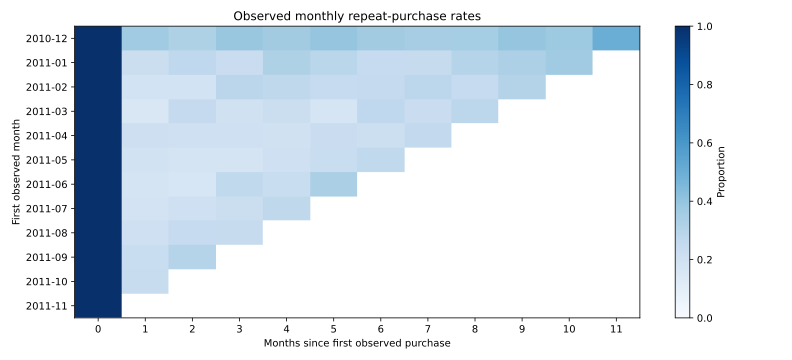

# Findings and commercial implications
**Observed historical analysis · Work in Progress · No campaign executed**

## Main finding
Under the documented segmentation rules, **852 active high-value customers (19.8% of customers) account for 69.3% of positive purchase value**. This suggests investigating service continuity and account development, subject to margin and customer-need evidence.

The segment is defined partly by purchase value, so concentration is partly built into its definition. It is not an independent discovery of profitability or a causal growth driver.

## Population and observed measures
| Measure | Result |
| --- | ---: |
| Original invoice lines | 541,909 |
| Eligible complete-month positive purchase lines | 375,666 |
| Known customers | 4,297 |
| Distinct invoices | 17,754 |
| Positive purchase value | GBP 8,370,018.45 |
| High-value threshold (75th percentile) | GBP 1,594.23 |
| Lapsed high-value customers | 107 |

See [cleaning waterfall](output/cleaning-waterfall.csv) and [segment summary](output/segment-summary.csv). None of these amounts is net revenue or profit.

## Temporal evidence
Using segments defined before September 2011:
- Active high value: 540 of 601 customers (89.9%) purchased in September–November.
- Lapsed high value: 59 of 103 (57.3%) purchased in the same period.

Inactivity at a snapshot is therefore not equivalent to permanent churn. These are observed differences in a historical window, not calibrated forecasts or effects of an intervention. See [holdout results](output/temporal-holdout.csv).

## Decision hypotheses
| Group | Proposed next investigation | What would justify action |
| --- | --- | --- |
| Active high value | Account needs and service continuity | Positive contribution and a specific customer problem |
| Lapsed high value | Buying cycles and inactivity reasons | Reachable, relevant customers and an economical randomized reactivation test |
| Recent single purchase | Second-purchase journey | Relevant offer, consent and measured incremental contribution |
| Active repeat | Product suitability and cross-sell | Incremental demand rather than displacement of existing purchases |

## Sensitivity and caution
Retaining otherwise-eligible exact duplicates adds GBP 23,196.66 to positive purchase value. Duplicate removal is therefore visible and testable, not silent.
The [cutoff sensitivity table](output/segment-sensitivity.csv) shows how analyst choices change segment counts and labels.

## What this does not establish
No campaign ROI, profitable segments, lifetime value, true churn or current-market opportunity is demonstrated. The source lacks margin and treatment exposure. Next, review adjustment/product codes and outliers; any campaign test should use random assignment and measure incremental contribution after costs.

[Executed notebook](customer-growth-analytics.ipynb) · [Data and definitions](DATA.md) · [Project home](README.md)
