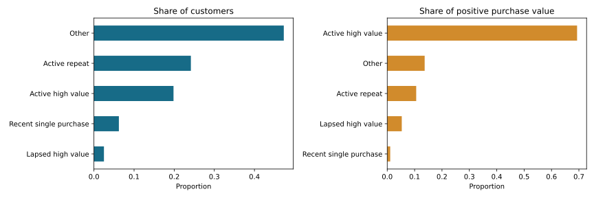

# Customer Growth Analytics
## Segmentation and repeat purchasing with real public data
**Work in Progress · v0.1 · locally executed analysis · Kaggle-compatible notebook**

Which customer groups merit investigation for retention, reactivation or development?

This project analyzes real historical transactions from UCI Online Retail. It connects data quality, customer behavior and commercial decisions through an executed notebook, three charts and an executive summary. No synthetic records are substituted.

## Start here
- [Executive findings](FINDINGS.md): observed results, interpretation and proposed actions.
- [Executed notebook](customer-growth-analytics.ipynb): code, tables, figures and methodological explanations.
- [Run in Kaggle](KAGGLE.md): import instructions and optional CLI metadata.
- [Data source and definitions](DATA.md): license, exclusions, dates and metric boundaries.

## What was executed
541,909 source lines were audited. The cleaned complete-month window contains 375,666 positive purchase lines, 4,297 known customers and 17,754 distinct invoices, covering December 2010–November 2011. Partial December 2011 is excluded.

The analysis includes RFM scoring, transparent action segments, monthly cohort repeat rates, a temporal holdout and sensitivity to segment cutoffs and duplicate handling. It is descriptive analytics, not a churn prediction or causal campaign model.



## Reproduce locally
Use Python 3.12. Create a dedicated environment, install `requirements.txt`, then run:
```sh
python analysis.py
```
Run from this project directory. Without a local file, the script downloads the original UCI archive. Alternatively set the `DATA_PATH` environment variable to the original `Online Retail.xlsx`. Aggregated outputs and charts are written to `output/`. The notebook contains the same analysis code and can be run top to bottom.

`requirements.txt` pins the direct packages used locally. Kaggle can use its preinstalled compatible packages; the notebook prints actual versions and checks source schema and counts. Kaggle execution has not been verified in this session.

## Verification and maturity
All seven analysis cells were executed sequentially in a local Python process. Notebook schema validation passed. Assertions verify row reconciliation, segment totals, cohort-rate bounds and temporal separation. All three charts were visually reviewed. This is not an independent methodological audit.

No Kaggle account is connected to this project and no Kaggle notebook URL is claimed. The notebook and integration instructions are ready to import; publication and a Kaggle run remain separate steps.

## Source and limits
Chen, D. (2015). [Online Retail](https://doi.org/10.24432/C5BW33). UCI Machine Learning Repository. **CC BY 4.0**. Source data were filtered, aggregated and segmented as documented in [DATA.md](DATA.md).

Amounts are GBP positive purchase value after exclusions, not net revenue or profit. Historical segments do not establish current customer needs, true churn, lifetime value or campaign impact. Prepared with AI assistance and executed for this portfolio; no client engagement or independent coding-proficiency claim is implied.

[Project overview](../PORTFOLIO-GUIDE.md) · [Portfolio home](../README.md) · [Growth Opportunity Explorer](../growth-opportunity-explorer/README.md)
