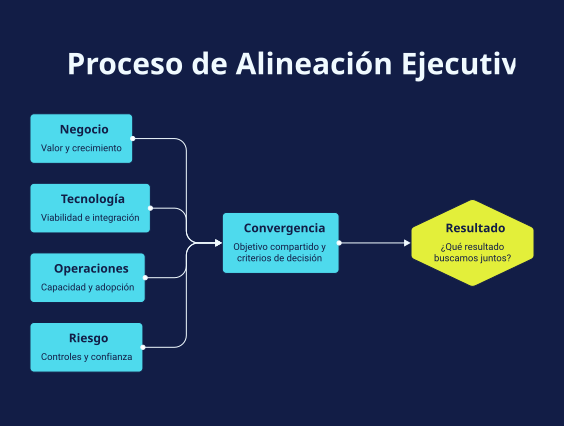

# Áreas con prioridades distintas

**Playbook de facilitación · v1.0 · Borrador conceptual para probar.**

## El reto
Las áreas pueden tener razones válidas para priorizar aspectos diferentes. Antes de discutir una solución conviene acordar el resultado buscado, las restricciones y los criterios que permitirán decidir juntos.

[Descargar visual SVG](visual.svg) · [Original editable en Napkin](https://app.napkin.ai/page/CgoiCHByb2Qtb25lEiwKBFBhZ2UaJGJkMDFmZGIzLTdkNTAtNDg4Ni1iYWMxLTJkYjIwODhlN2FkNw) — puede requerir acceso del propietario.

## Perspectivas para explorar
| Perspectiva ilustrativa | Qué preguntar |
| --- | --- |
| Negocio: valor y crecimiento | ¿Qué resultado buscamos y para quién? |
| Tecnología: viabilidad e integración | ¿Qué dependencias y limitaciones debemos conocer? |
| Operaciones: capacidad y adopción | ¿Qué cambiaría en el trabajo y quién podría sostenerlo? |
| Riesgo: controles y confianza | ¿Qué condiciones debemos cumplir para avanzar? |

Estas perspectivas no definen funciones exclusivas ni son una lista exhaustiva. Incorporar clientes, personas, finanzas u otras voces cuando el caso lo requiera.

## Tres preguntas para abrir la conversación
1. ¿Qué resultado buscamos juntos y qué necesita proteger o conseguir cada área?
2. ¿Qué tensiones reflejan restricciones reales y cuáles son supuestos por comprobar?
3. ¿Qué criterios y qué responsable de decisión necesitamos acordar para avanzar?

## Cómo facilitarlo en 25 minutos
- **3 min — Foco:** formular el reto sin atribuir culpas ni anticipar la solución.
- **8 min — Escucha:** dar a cada perspectiva tiempo para expresar una necesidad y una restricción. Confirmar lo entendido.
- **8 min — Convergencia:** proponer un objetivo y hasta tres criterios compartidos. Explicitar desacuerdos y quién resolverá los compromisos; no forzar unanimidad.
- **6 min — Acuerdo:** elegir un siguiente paso reversible, con responsable, fecha y evidencia pendiente. Llevar los temas fuera del objetivo al parking lot.

**Pregunta de desbloqueo:** ¿Qué necesitamos acordar antes de discutir soluciones?

## Resultado esperado — completar durante la sesión
- Objetivo compartido:
- Criterios de decisión:
- Restricciones confirmadas:
- Supuestos pendientes de validar:
- Tensiones o desacuerdos que permanecen:
- Responsable de la decisión:
- Siguiente paso / responsable / fecha:
- Parking lot:

## Historia breve para presentarlo
“Cuando cada área mira una parte distinta del reto, una misma propuesta puede parecer urgente, inviable o riesgosa. Este mapa permite escuchar esas razones y acordar cómo decidir antes de debatir soluciones.”

## Uso y límites
Las conexiones representan perspectivas que se integran, no una secuencia de aprobaciones. Un objetivo compartido puede formularse al inicio y revisarse al cierre; el gráfico no prescribe un proceso rígido. No garantiza consenso ni acredita resultados de facilitación. Preparado con asistencia de IA y Napkin AI; todavía sin validación con audiencia.

**Después de probar:** registrar si todos pudieron expresar sus necesidades, qué criterios se acordaron y si el siguiente paso quedó claro. No atribuir resultados colectivos exclusivamente al facilitador.

[Volver a la colección](../README.md)
