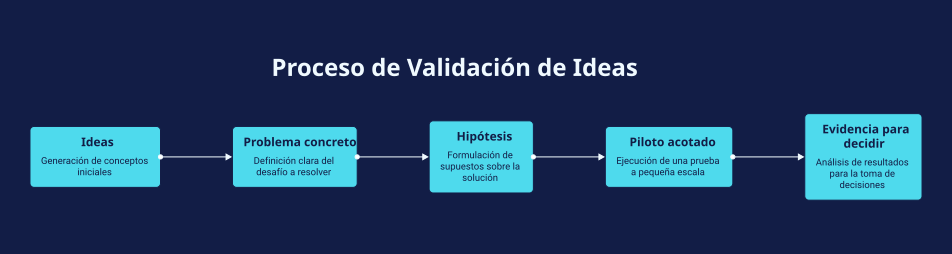

# Muchas ideas de IA, pocos pilotos definidos

**Playbook de facilitación · v1.0 · Borrador conceptual para probar.**

## El reto
Existen propuestas de IA, pero falta claridad sobre qué problema resolver, qué supuesto comprobar y cómo elegir una prueba acotada. Esta guía ayuda a avanzar desde una lista de ideas hacia una decisión de experimentación.

[Descargar visual SVG](visual.svg) · [Original editable en Napkin](https://app.napkin.ai/page/CgoiCHByb2Qtb25lEiwKBFBhZ2UaJDE0MDdjNjkwLWViZGYtNDFjNi1hYzUyLTY2NTE4NDU2M2RkZQ) — puede requerir acceso del propietario.

## Tres preguntas para abrir la conversación
1. ¿Qué problema de negocio queremos resolver y quién necesita una mejora?
2. ¿Qué supuesto crítico necesitamos comprobar mediante una prueba pequeña?
3. ¿Qué evidencia nos haría continuar, ajustar o detener el piloto?

## Cómo facilitarlo en 20 minutos
- **3 min — Enmarcar:** pedir un ejemplo concreto del problema; distinguir síntomas y consecuencias.
- **5 min — Localizar:** recorrer las cinco etapas y preguntar dónde falta claridad. No asumir que toda idea requiere IA.
- **7 min — Diseñar:** elegir una oportunidad y acotar usuarios, datos autorizados, alcance y duración. Comparar con una alternativa más simple cuando sea pertinente.
- **5 min — Cerrar:** acordar responsable, referencia de comparación, medida de éxito y fecha de revisión. Si falta evidencia, definir primero cómo obtenerla.

**Pregunta de desbloqueo:** ¿En qué paso nos estamos quedando y qué falta para avanzar?

## Resultado esperado — completar durante la sesión
- Problema y usuario:
- Oportunidad elegida:
- Hipótesis comprobable:
- Alternativa de comparación / situación actual:
- Alcance y duración del piloto:
- Medida de éxito y evidencia requerida:
- Criterios para continuar, ajustar o detener:
- Responsable y fecha de revisión:
- Preguntas pendientes:

## Historia breve para presentarlo
“Una lista de ideas es un punto de partida. Para elegir qué probar necesitamos hacer explícitos el problema, la hipótesis y la evidencia que permitiría decidir. Este recorrido ayuda a descubrir qué conversación falta antes de invertir en un piloto.”

## Uso y límites
El visual organiza la conversación; no mide madurez ni sustituye una evaluación de viabilidad. La secuencia puede recorrerse varias veces al aprender. No implica que un piloto se haya ejecutado o que la IA sea la mejor alternativa. Versión preparada con asistencia de IA y Napkin AI; todavía sin validación con audiencia.

**Después de probar:** registrar qué pregunta aclaró el reto, qué acuerdo se produjo y qué debería cambiarse. Separar percepciones de utilidad de resultados de negocio.

[Volver a la colección](../README.md)
